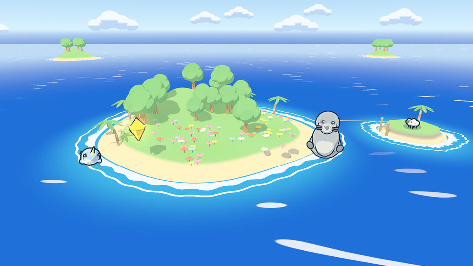
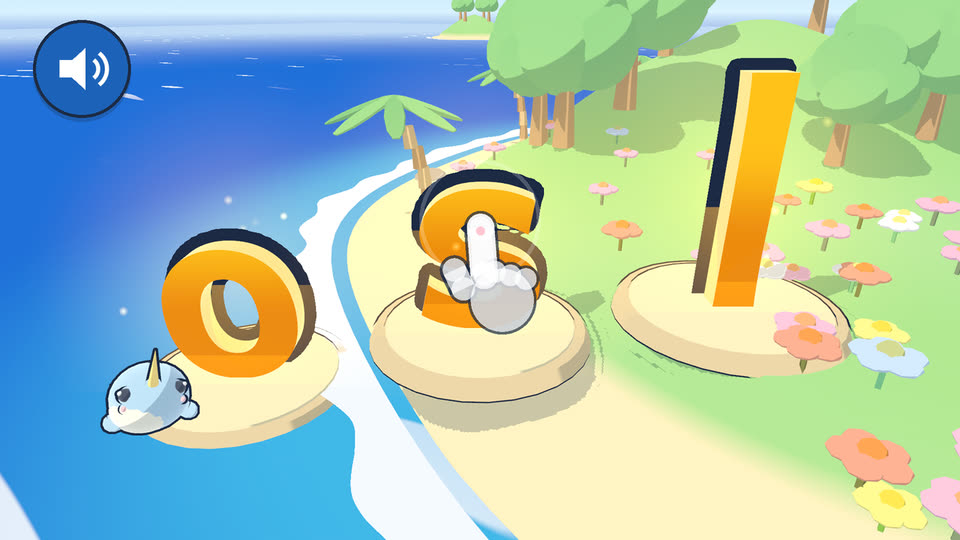
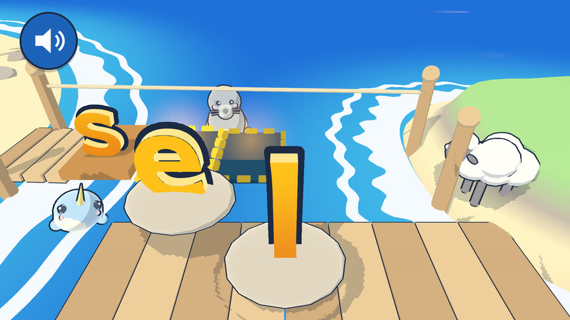

# MWM Les

A 3D reading adventure for Norwegian children aged 4 to 7. Pip, a small narwhal, wants
to build a bridge of letters so that Pip's best friend, a lamb on a little islet, can
cross the water. The child helps: finds letters by their sound, writes them in the sand
and lays them as six short words (sol, sel, les, mat, båt, lam). Every instruction is
spoken in Norwegian (bokmål), so a child who cannot read yet can play alone.
**No ads, no in-app purchases, no timers, no tracking, no internet permission.**

  
  
  

<em>The island with a station lit, finding a letter by its sound, and laying the word
sel on the bridge.</em>

## Download

**Direct APK download:**
https://github.com/Matswm86/mwm-les/releases/download/latest/mwm-les.apk

1. Open that link in your phone's or tablet's browser and tap to download.
2. When you open the file, Android may ask you to allow installs from this source.
   Tap **Settings**, turn on **Allow from this source**, go back and install.
3. The app appears as **MWM Les**. It plays in landscape.

The APK is debug-signed with a stable key, so a newer build installs over an older one
and keeps the child's progress. Builds made before 3 October 2026 at 21:30 used a
one-off key: uninstall that version once before installing a newer one.

## How to play

Pip's best friend, a lamb, stands on a little islet across the water and cannot swim.
Pip wants to build a bridge of letters, and the child helps. On the first launch Pip
tells this in a short opening; the child taps Pip to start. One play is six word levels,
in this order: **sol, sel, les, mat, båt, lam**. In every level Pip swims to one lit
station at a time, three in all, and the level's word is the task at each of them.

| Activity | What the child does | Based on |
|---|---|---|
| Hør og finn (listen and find) | Pip asks which letter says a sound, then plays the sound. The child taps the letter on the sand tiles; a tapped letter says its own sound. Each letter of the word is asked twice (once in a review play). A new letter is introduced by name and sound while its tile glows. Press and hold a letter to hear its name and sound. | Systematic letter-sound teaching |
| Sandskriving (sand writing) | A new letter: Pip writes it in the sand twice while its sound plays, the child follows the striped letter with a finger, then writes it alone. A letter from an earlier level is written once, alone. An accepted letter lifts out as a stone and rolls off to the bridge. | Watch, then write from memory |
| Ordbroa (the word bridge) | Pip says the word and sounds it out while the planks light up, then asks which letter is missing, plank by plank. The child drags the right stone into the gap. When the word is laid, its planks sink into the bridge, which grows toward the islet. | Moveable alphabet, connected blending |

Each level brings in the letters of its word that the child has not met yet. After `lam`
the bridge reaches the islet and the lamb walks over. Then Pip says goodnight, and a tap
starts a new play from `sol` as a review. Progress is saved after every level. Wrong
answers never end anything: the letter says its own sound and the child hears the right
sound again.

## How it works

MWM Les is a Godot 4.6 project in GDScript with the mobile renderer, built into an
Android APK by GitHub Actions. The 3D island is drawn with a cel-shaded look: a toon
light shader with a two-tone shadow, an outline shell on things the child can touch, and
unshaded gold letters with a halo. Every spoken line is a real person's recording (one
file per line, listed in [docs/SCRIPT.md](docs/SCRIPT.md)), so the app never needs the
internet and uses no synthetic voice; one audio player plays one clip at a time, and a
letter sound always comes last in a sequence. The six levels are a fixed list in the
game code, and the letter shapes the writing check compares against come from a content
pack in `content/nb_reading/`. A separate learning engine (`scripts/learn_core/`: a
mastery estimate per skill, a 70-85% target success rate, a hint ladder) is kept, with
its own tests, but does not choose the tasks in this build. The teaching follows reading
research, checked source by source in [docs/RESEARCH.md](docs/RESEARCH.md): letter sounds
in a fixed order, sounds held and blended together (/sssooolll/ → *sol*), and letters
written from memory after Pip has shown them.

## Status

Early test build, version 0.1.0: one island, six word levels, nine letters (a, s, o, l,
e, m, t, b, å). Not built yet: the other five worlds of the design draft in
[docs/GDD.md](docs/GDD.md) (written before the lamb's bridge story and partly
superseded by it), the read-to-a-grown-up card and the parent page (the code is in
`scripts/ui/` but is not connected to the game).

## Credits

- Character model: [KayKit Adventurers](https://github.com/KayKit-Game-Assets/KayKit-Character-Pack-Adventures-1.0)
  by Kay Lousberg (CC0), kept in `assets/characters/` but not used in the current build.
  Full asset list and licences: [docs/ASSETS.md](docs/ASSETS.md).
- Font: [Andika](https://software.sil.org/andika/) by SIL, designed for beginning
  readers (SIL Open Font License, see `assets/fonts/OFL.txt`).

## Run from source

1. Install **Godot 4.6.x** from https://godotengine.org/.
2. Import `project.godot` and press **F5**. The mouse works as a finger.

The engine tests run headless from `tests/`. `tests/capture.tscn` is a dev-only scene
(not exported) where a bot plays the whole island and saves screenshots; run it under
Xvfb with `CAPTURE_DIR=/some/dir` and `--audio-driver Dummy`.

## Build

GitHub Actions builds the APK on every push to `main`
(`.github/workflows/build-android.yml`) and publishes it to the rolling `latest`
release.

## License

Code: MIT (see `LICENSE`). Third-party assets keep their own licences, listed in
[docs/ASSETS.md](docs/ASSETS.md).
